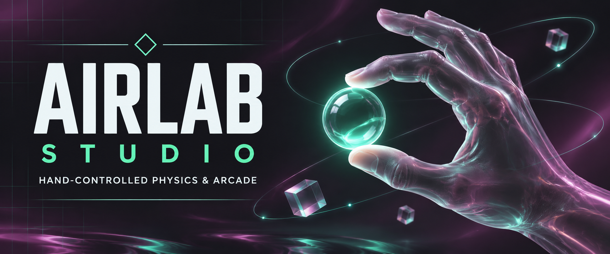

# AirLab Studio

**A hand-controlled physics playground and two original arcade games.** Use an ordinary webcam to grab objects, build structures, run motion experiments, or play with up to four tracked hands. The same app supports mouse and touch. Built for JIT INNOVATE 2026.

## Run AirLab

1. Install [Node.js](https://nodejs.org/) 22 or newer.
2. Clone or download the repository, then open a terminal in the project folder.
3. Run:

   ```sh
   node serve.mjs
   ```

4. Open [AirLab on localhost](http://localhost:4173) in Chrome or Edge. Select **Enable hand tracking** and allow camera access, or try the playground immediately with a mouse.

AirLab bundles its runtime libraries and hand model. The web version needs Node.js for the local server and runs without a package installation, account, or API key. A hosted copy needs HTTPS for camera access. For the Windows desktop build, see [AirLab for Windows](desktop/WINDOWS-APP.md).

## Playground and experiments

| Area | What you can do |
| --- | --- |
| Playground | Spawn orbs, blocks, and triangles in rubber, ice, steel, or cork. Compare Earth, Moon, zero, and reverse gravity. Use motion trails, velocity arrows, or slow motion to inspect a throw. |
| Build | Draw platforms, create paired portals, attach ropes or springs, and freeze or clone objects. Pinch the same object with two hands to stretch and rotate it. |
| Physics Lab | Place straight ramps or curved slides. Run controlled incline and free-fall trials, or record a selected object and compare displacement, velocity, and acceleration. Export measurements as CSV. |
| Scenes | Explore momentum, basket shots, pendulums, springs, suspension bridges, and more. Save a scene locally or export and import it as JSON. |

Trials measure simulated motion. A webcam provides control input and does not measure the motion of real objects.

## Arcade

Press **Shift+G** or quickly tap the **◈ AirLab emblem** three times.

- **Orbit Breaker** has 12 space siege missions across three sectors. Pinch and pull back a probe, then release to launch it at signal cores. Eligible missions let you trigger a mid-flight **Nova** pulse with **X** or the Nova button. Earn stars and unlock new missions.
- **Citrus Circuit** has three neon arenas. Each round gets faster across three phases. Open **Blade** to equip one of six swords. The blade tip follows your index fingertip, and its angle follows your finger direction. Pinch and swipe to cut fruit, chain combos, and catch gold fruit while avoiding red drones. Your equipped blade is saved on the device.

## Controls

| Input | Action |
| --- | --- |
| Point with index finger | Move the hand cursor or aim the Citrus Circuit blade |
| Pinch thumb and index finger | Grab an object, activate controls, or start an arcade action |
| Move, then open fingers | Release a grabbed or launched object |
| Mouse or touch drag | Grab, launch, or slice without the camera |
| **Space** | Pause or resume while focus is outside interactive controls |
| **R** / **F** | Reset the playground / toggle focus mode |
| **Esc** | Back out of arcade menus |

Open **Camera settings** to choose a built-in or USB webcam, set the hand limit to one, two, or four, and adjust hand response. Start with Auto performance. Fast reduces drawing effects and input resolution. The tracking panel displays camera delivery, detector results, and display updates separately. Tracking speed and precision depend on the camera, lighting, and computer.

## How it works

- [`dist/`](dist/) contains the browser app, interface, scenes, and games. Canvas draws the playground and the arcade.
- [`dist/hand-control.mjs`](dist/hand-control.mjs) maps camera landmarks to gestures. A dedicated worker processes the latest available frame without queueing camera frames. A time-based filter updates cursor and blade positions between camera detections.
- [`desktop/`](desktop/) contains the Windows WebView2 wrapper and build script. It serves the app on a local loopback address.
- [`tests/`](tests/) covers physics and scene loading, arcade controls and unlocks, fingertip alignment, and camera lifecycle.

Camera frames are processed on the device. AirLab requests video only and does not upload camera frames. Camera selection, local scene saves, and arcade progress are stored by the browser or desktop app.

## Verify a change

```sh
node --check dist/app.js
node --check dist/hand-control.mjs
node --test tests/*.test.mjs
```

## Credits

- **Matter.js 0.20.0** (Liam Brummitt) provides the physics engine. [Bundled MIT license](dist/vendor/MATTER-LICENSE.txt)
- **MediaPipe Tasks Vision 0.10.18** and the **MediaPipe Hand Landmarker** model (Google) provide hand landmarks. [Bundled MediaPipe license](dist/vendor/MEDIAPIPE-LICENSE.txt)
- The Windows wrapper uses **Microsoft Edge WebView2**. [Build requirements](desktop/WINDOWS-APP.md)
- AI assistance was used in development and for visual assets.
